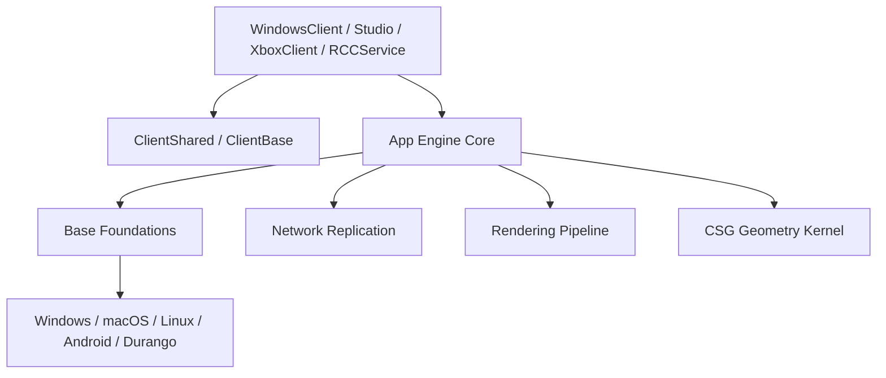

# Codebase Architecture & Function Hub

Welcome to the automated architectural reference and function-by-function documentation for the **R2K16** engine. This documentation thoroughly covers **every function across the codebase**, its **internal implementation**, **how it is used and verified in test suites**, and **whether its behavior differs across target platforms and actual code files**.

:::info Automated Documentation System
This documentation is **generated and maintained entirely via automated Python scripts** located in `scripts/docgen/`. It automatically scans all source and test files on every build, detecting newly added functions and tests to guarantee that documentation never drifts from the actual source code.
:::

## Key Engine Metrics

| Metric | Count | Description |
| :--- | :--- | :--- |
| **Documented Engine Functions** | **25,310** | Distinct C++, C#, and Python functions parsed and analyzed across all core modules |
| **Parsed Test Cases** | **432** | Unit, regression, and benchmark test cases mapped from Boost and MSUnit suites |
| **Functions with Test Coverage** | **1,889** | Functions directly tested, asserted, or exercised within test scenarios |
| **Platform-Divergent Functions** | **1,735** | Functions with `#ifdef` branching or multi-file implementations across platforms |

---

## Architectural Subsystems

### 1. Engine & Foundations
- **[Base Foundations](./base.md)**: Threading, `TaskScheduler`, `Time`, intrusive pointers, signals, memory allocators, assertions, and string formatting.
- **[App - DataModel & Hierarchy](./app-datamodel.md)**: Core `DataModel`, `Workspace`, `Players`, `Lighting`, and engine services.
- **[App - Instance Tree](./app-tree.md)**: The foundational `Instance` hierarchy, property descriptors, and scripting bindings.
- **[App - World Simulation & Physics](./app-physics.md)**: Physics world, mechanisms, assemblies, primitives, and contact generation.
- **[App - Solvers & Humanoids](./app-solvers.md)**: PGS constraint solver, Featherstone articulated-body algorithms, and Humanoid state machines.
- **[App - Scripting & Lua VM](./app-scripting.md)**: Lua-5.1 / Luau VM integration, `ScriptContext`, sandbox security, and debugger.
- **[App - Reflection System](./app-reflection.md)**: Runtime type reflection, `ClassDescriptor`, `PropertyDescriptor`, and event signals.
- **[App - Serialization & XML](./app-serialization.md)**: XML and binary `.rbxl` / `.rbxm` serializers and web asset parsers.
- **[App - Voxel Terrain Engines](./app-terrain.md)**: Voxel occupancy grid, smooth terrain v2, and spatial acceleration structures.
- **[App - Tools & User Input](./app-tools-gui.md)**: Studio draggers, Selection system, `UserInputService`, and GUI widgets.
- **[App - Utilities & Math](./app-utilities.md)**: `ThreadPool`, HTTP client, G3D primitives, math functions, and URL parsers.
- **[App - Security & Validation](./app-security.md)**: Security context enforcement, hash validation, and script signing.
- **[App - Engine Core](./app-core.md)**: Core engine runtime headers, shared data structures, and foundational classes.

### 2. Networking, Graphics & Geometry
- **[Network & Replication](./network.md)**: RakNet replication stack, Client/Server Replicators, physics senders/receivers, and cluster buffers.
- **[Rendering Pipeline](./rendering.md)**: `GfxBase`, `GfxCore`, DirectX (D3D9/D3D11), OpenGL backends, scene graph, and shaders.
- **[CSG Geometric Kernel](./csg.md)**: Constructive Solid Geometry boolean operations over solid meshes.

### 3. Clients, Applications & Services
- **[Client Shared Subsystems](./client-shared.md)**: Cross-platform `CookiesEngine`, `DataModelSerialize`, and SDL game controllers.
- **[Client Base Configuration](./client-base.md)**: `MachineConfiguration`, `ReflectionMetadata`, and graphics settings.
- **[Windows Client & Win Launcher](./windows-client.md)**: Windows desktop player, launcher utilities, crash uploaders, and hooks.
- **[Roblox Studio IDE](./roblox-studio.md)**: Qt-based Studio editor, ribbon framework, docking widgets, and plugins.
- **[RCCService Game Server](./rcc-service.md)**: Headless game host, job scheduler, and RCC Arbiter coordination.
- **[Xbox Client Subsystems](./xbox-client.md)**: Xbox Durango UWP client, voice chat, and controller buffers.
- **[Tooling & Test Hooks](./tooling-and-hooks.md)**: `RbxTestHooks` DLL and `CoreScriptConverter2`.

### 4. Cross-Cutting Analysis & Directories
- **[Test Verification Matrix](./test-verification-matrix.md)**: Detailed mapping of every test case and assertion across all test suites.
- **[Platform & Cross-File Divergence Matrix](./platform-divergence-matrix.md)**: Comprehensive guide to platform-specific code and multi-file variants.
- **[Complete Function Catalog](./function-catalog.md)**: Alphabetical and module-indexed catalog of all documented functions.
